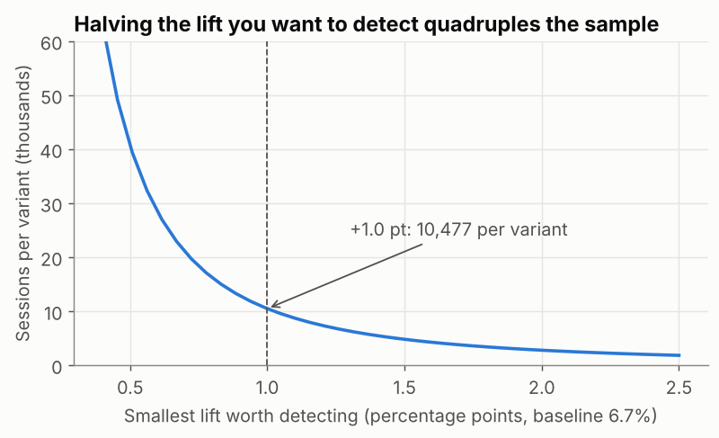

## What is it?

| Topic | Question |
|---|---|
| **Sample size** | How much data do we need to reliably detect the smallest effect worth acting on? |
| **Causal pitfalls** | What can make us believe X causes Y when it doesn't, especially without randomisation, or when we analyse an experiment badly? |

!!! job "Why it matters at work"
    Most failed experiments are failed **designs**: too small to detect anything, stopped early on a lucky day, or analysed on whatever metric looked best. And most "insights" from dashboards are correlations that a confounder explains. Spotting these is what makes an analyst's recommendations safe to act on.

The script is `14_ab_sample_size_pitfalls.py`.

## Part 1: sample size and power

Four numbers decide the sample size:

| Input | Our choice | Meaning |
|---|---|---|
| **Baseline rate** | 6.7% | Current conversion |
| **Minimum detectable effect (MDE)** | +1.0 point | The smallest lift worth shipping |
| **α (significance level)** | 0.05 | Accepted false-positive rate |
| **Power (1 − β)** | 80% | Chance of detecting the MDE *if it's real* |

```python
from statsmodels.stats.power import NormalIndPower
from statsmodels.stats.proportion import proportion_effectsize

baseline, mde = 0.067, 0.010
effect = proportion_effectsize(baseline + mde, baseline)          # Cohen's h
n_per_group = NormalIndPower().solve_power(effect_size=effect, alpha=0.05, power=0.80, ratio=1.0)
print(f"Cohen's h = {effect:.4f} -> {np.ceil(n_per_group):.0f} sessions per variant (80% power, alpha 0.05)")
```

```text
Cohen's h = 0.0387 -> 10477 sessions per variant (80% power, alpha 0.05)
```

About **10,500 sessions per variant**, roughly 21,000 in total. The portal gets 387 sessions a day, so:

```text
detect +0.5 pt:  40,595 per variant, ~210 days at 387 sessions/day
detect +1.0 pt:  10,477 per variant, ~55 days at 387 sessions/day
detect +1.5 pt:   4,799 per variant, ~25 days at 387 sessions/day
detect +2.0 pt:   2,778 per variant, ~15 days at 387 sessions/day
```



**Halving the effect you want to detect quadruples the sample.** Small effects on low conversion rates need a lot of traffic, so negotiate the MDE with the business before the test, in terms of money ("+1 point ≈ X orders a month").

### Was our November test big enough?

```text
power of our test for +1.0 pt: 52%
```

The 4-week test had only **52% power** for a +1-point lift: a coin flip. It found a significant result because the true effect seems a bit larger (+1.2), but a team planning properly would have run it for about **8 weeks**. Underpowered tests mostly produce "not significant", and the significant ones tend to **overestimate** the effect.

## Part 2: peeking — checking every day

What if you check the p-value every day and stop as soon as p < 0.05? The script simulates 2,000 **A/A tests** (both groups get the same experience, so there's no real effect), 28 days each:

```python
for _ in range(n_sims):
    a = rng.binomial(1, p, (days, per_day)).sum(axis=1).cumsum()
    b = rng.binomial(1, p, (days, per_day)).sum(axis=1).cumsum()
    n = per_day * np.arange(1, days + 1)
    pvals = [proportions_ztest([b[d], a[d]], [n[d], n[d]])[1] if a[d] + b[d] > 0 else 1 for d in range(days)]
    fp_end += pvals[-1] < 0.05
    fp_peek += min(pvals) < 0.05
```

```text
A/A tests with no real effect: 'significant' at the end 4.5%, 'significant' on ANY day if you peek daily 26.5%
```

Analysed once at the end, about 5% of no-effect tests look significant, as designed. Stopping on the first day with p < 0.05 makes it **26.5%**: more than **five times** the false-positive rate you think you have.

**Fixes:** fix the duration in advance (full weeks); if you must monitor, use methods designed for it (sequential tests, always-valid p-values), which many experimentation platforms provide.

## Part 3: causal pitfalls

### Confounding: a third variable drives both

Question from management: *"Portal orders are cancelled less often. Should we push every customer to the portal?"* This is **observational** data: customers chose their channel, so nothing was randomised.

```python
overall = orders.groupby("channel")["cancelled"].mean().mul(100).round(1)
within = orders.pivot_table(index="segment", columns="channel", values="cancelled", aggfunc="mean").mul(100).round(1)
```

```text
cancellation rate by channel (%): {'Phone': 9.5, 'Portal': 5.8, 'Sales rep': 6.3}
channel          Phone  Portal  Sales rep
segment
Garment Factory    9.6     6.0        5.6
Knitting Mill      6.7     4.9        8.2
Retailer          15.2     9.5       11.0
Trader             8.1     5.1        3.5
```

And who uses each channel (% of each channel's orders):

```text
segment    Garment Factory  Knitting Mill  Retailer  Trader
channel
Phone                 51.0           17.0      13.0    19.0
Portal                77.0           16.0       2.0     5.0
Sales rep             53.0           17.0      12.0    19.0
```

- **Portal orders come mostly from garment factories (77%)** and almost never from retailers (2%), the segment that cancels most. Part of the portal's lower rate is simply **who uses it**: segment is a **confounder**.
- **Within** each segment, portal vs sales rep goes both ways (lower for mills and retailers, higher for factories and traders), and some cells are tiny (only 42 retailer portal orders: 4 cancellations). There's no consistent portal effect.
- Phone orders are consistently worse in every segment. That's worth investigating, but it's still not proof: maybe customers who are unsure phone in.

**Conclusion:** the data can't show that moving customers to the portal would reduce cancellations. To know, **randomise**: for example, offer a portal incentive to a random half of phone customers and compare.

When the confounding is strong enough, the overall and within-group comparisons point in **opposite directions**. That's called **Simpson's paradox**.

### Other traps

| Pitfall | Example | Defence |
|---|---|---|
| **Selection bias** | Surveying only customers who stayed | Define the population before collecting data |
| **Reverse causation** | Big orders get discounts (EDA lesson) | Check timing and business rules |
| **Novelty effect** | Users click a new design because it's new, then it wears off | Run full weeks; check the effect over time |
| **Multiple testing** | Testing 20 metrics or segments: about 1 will be "significant" by chance | One primary metric; correct for multiple tests |
| **Survivorship** | Studying only successful launches | Include the failures |
| **Peeking / optional stopping** | Stopping on a lucky day | Fix the duration; sequential methods |

## Common mistakes

| Mistake | What happens | Fix |
|---|---|---|
| No sample size calculation | Underpowered tests, "no result" after weeks | Power analysis with an agreed MDE |
| MDE chosen to fit the traffic | A test that can only detect huge effects | Start from the business value of a lift |
| Daily "is it significant yet?" | Up to 5× more false positives | Fixed horizon or sequential tests |
| Treating observational gaps as effects | Wrong strategy (push everyone to the portal) | Compare within groups; randomise to be sure |
| Ignoring tiny cells | 4 cancellations driving a conclusion | Always show counts |

## Try it yourself

**Task:** The CFO wants more certainty: 95% power instead of 80% for the +1-point lift. How many sessions per variant does that need, and how much longer would the test run?

<details markdown="1">
<summary>Show the solution</summary>

```python
n95 = NormalIndPower().solve_power(effect_size=effect, alpha=0.05, power=0.95)
print(f"95% power: {np.ceil(n95):,.0f} per variant ({np.ceil(n95) / np.ceil(n_per_group):.2f}x the 80% design)")
```

```text
95% power: 17,346 per variant (1.66x the 80% design)
```

About **66% more data**: roughly 90 days instead of 55 at 387 sessions a day. A fair trade-off conversation: is lowering the chance of *missing* a real +1-point lift from 20% to 5% worth five more weeks?
</details>

## Quick quiz

<div class="quiz-q" markdown="1">
1\. You want to detect a lift half as large as before. Roughly how does the sample size change?

1. It doubles
2. It quadruples
3. It halves

<details markdown="1"><summary>Show answer</summary>
**B.** Sample size grows with 1 ÷ effect².
</details>
</div>

<div class="quiz-q" markdown="1">
2\. Why does stopping a test on the first day p < 0.05 cause problems?

1. It makes tests run too long
2. It greatly increases the chance of a false positive
3. It reduces the effect size

<details markdown="1"><summary>Show answer</summary>
**B.** In the simulation, from 4.5% to 26.5%.
</details>
</div>

<div class="quiz-q" markdown="1">
3\. Portal orders cancel less, but portal users are mostly large factories. What is segment here?

1. The outcome
2. A confounder
3. The treatment

<details markdown="1"><summary>Show answer</summary>
**B.**
</details>
</div>

## Summary

- Size every experiment **before** it starts: baseline, MDE, α and power give the sample; traffic gives the duration.
- Underpowered tests waste time and exaggerate the effects they do find.
- **Don't peek and stop**: it multiplies false positives. Fix the horizon or use sequential methods.
- Without randomisation, look for **confounders**, compare within groups, show counts, and recommend an experiment when the decision matters.

!!! job "Job-ready check"
    **Interview question:** *"Our dashboard shows that customers who use feature X spend 30% more. Should we make everyone use it?"*

    **Strong answer:** "Not yet. Users chose feature X, so they probably differ from non-users: larger, more engaged customers. That's confounding, and possibly reverse causation. I'd compare like-for-like segments to see how much of the gap remains, and then propose an A/B test, such as promoting X to a random half of users, sized with a power analysis for the smallest lift worth acting on."

    **Mini project:** Write an experiment plan for "portal incentive for phone customers": hypothesis, randomisation unit, primary and guardrail metrics, MDE, sample size and duration, and the pitfalls you'll guard against.
