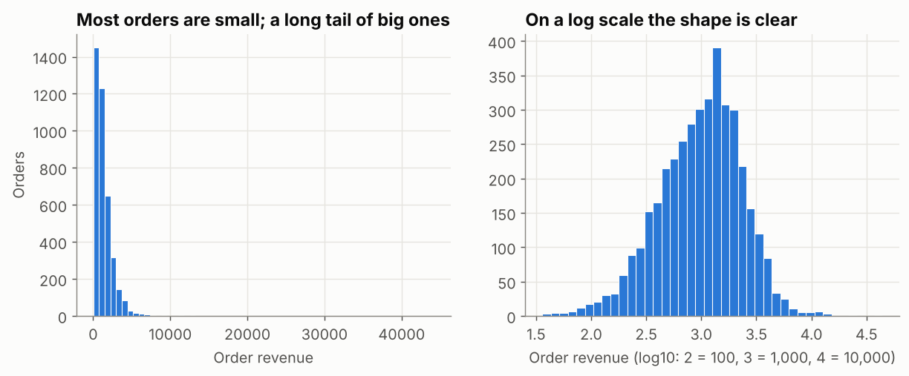
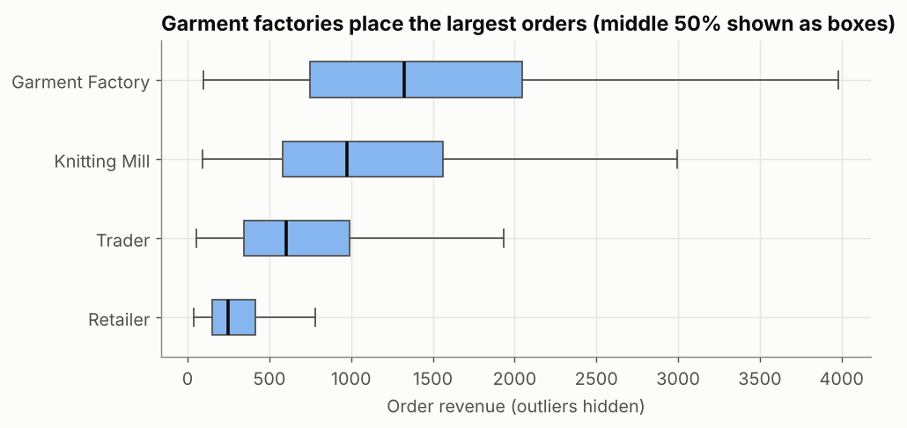
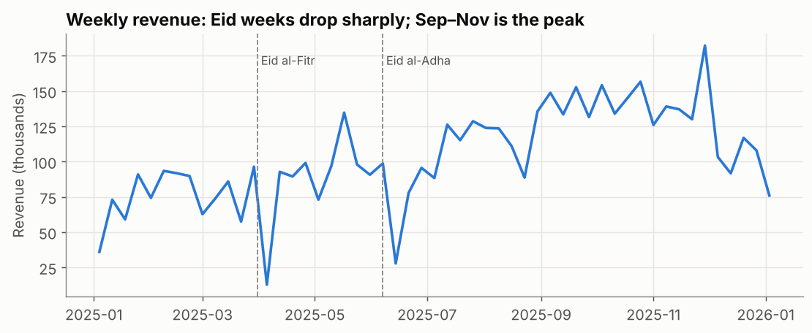

## What is it?

**EDA** is a structured first look at data to understand it before reporting or modelling. It has three parts:

| Part | Question | Typical tools |
|---|---|---|
| **Analytical questions** | What do we need to know, and can this data answer it? | A short question list, a data profile |
| **Distributions** | What values does one variable take, and how often? | `describe`, percentiles, histogram, box plot |
| **Patterns** | How do values change over time or across groups? | `resample`, `groupby`, line and bar charts |

(Relationships between variables and anomalies are Part 2.)

!!! job "Why it matters at work"
    Managers rarely ask precise questions; "how's sales doing?" is typical. Turning that into answerable questions, and spotting skew, seasonality and data issues early, is what separates an analyst from a report generator. Data science interviews often include a take-home EDA task.

The script is `09_eda_patterns_distributions.py`.

## Step 1: from a vague request to analytical questions

The sales director says: *"Give me a picture of 2025."* Rewrite it as questions that have a measurable answer:

| Vague | Analytical question | Data needed |
|---|---|---|
| How did we do? | What was net revenue per month, and how did it compare with the previous month? | `order_date`, `revenue`, `status` |
| Who matters? | What share of revenue comes from each segment and the top 10 customers? | `segment`, `customer_id` |
| What's a typical order? | What's the median order value, and how big are the largest orders? | `revenue` |
| Any problems? | How often are deliveries late, and where and when? | `delivery_days`, `promised_days`, `region` |

Write questions **before** charts, so you know when you're done.

## Step 2: profile the data

```python
profile = pd.DataFrame({
    "dtype": orders.dtypes.astype(str),
    "missing": orders.isna().sum(),
    "distinct": orders.nunique(),
})
print(profile.loc[["order_date", "customer_id", "region", "segment", "product", "quantity", "revenue", "delivery_days"]])
```

```text
                        dtype  missing  distinct
order_date     datetime64[us]        0       340
customer_id               str        0        60
region                    str        0         5
segment                   str        0         4
product                   str        0        12
quantity                int64        0      2505
revenue               float64        0      4169
delivery_days         float64      374        17
```

340 order dates in a 365-day year (Fridays and holidays are missing), 60 ordering customers, and 374 missing delivery times we already explained in the Cleaning lesson.

## Step 3: the distribution of order revenue

```python
rev = net["revenue"]
print(rev.describe(percentiles=[0.1, 0.5, 0.9, 0.99]).round(0))
print("skewness:", round(rev.skew(), 2))
```

```text
count     3963.0
mean      1382.0
std       1469.0
min         36.0
10%        313.0
50%       1060.0
90%       2698.0
99%       6015.0
max      44128.0
Name: revenue, dtype: float64
skewness: 9.27
```



How to read it:

- **Right-skewed** (skewness 9.27; 0 would be symmetric): many small orders, a few huge ones.
- The **mean (1,382) is above the median (1,060)** because the big orders pull it up. For "a typical order", report the **median**.
- The 99th percentile is 6,015 but the maximum is 44,128: a handful of bulk orders. They're real (see Cleaning), and they matter for revenue, but they would dominate any average.
- A **log scale** turns the squashed left chart into a readable shape. Money, quantities and web traffic are often skewed like this.

## Step 4: distributions by group

```python
print(net.groupby("segment")["revenue"].describe()[["count", "25%", "50%", "75%", "max"]].round(0))
```

```text
                  count    25%     50%     75%      max
segment
Garment Factory  2594.0  750.0  1327.0  2048.0  44128.0
Knitting Mill     643.0  579.0   977.0  1560.0  13927.0
Retailer          256.0  150.0   247.0   415.0   4706.0
Trader            470.0  342.0   602.0   991.0   4104.0
```



A **box plot** shows the median (thick line), the middle 50% of orders (the box, from the 25th to the 75th percentile) and the typical range (whiskers). A typical garment-factory order is about **5× a typical retailer order**.

## Step 5: patterns over time

```python
weekly = net.set_index("order_date")["revenue"].resample("W-SAT").sum() / 1000
print(weekly.idxmin().date(), round(weekly.min(), 0), "|", weekly.idxmax().date(), round(weekly.max(), 0))
```

```text
2025-04-05 13.0 | 2025-11-29 182.0
```



- `"W-SAT"` makes weeks that end on Saturday. (The first and last weeks of the year are partial, so ignore their dips.)
- **Pattern 1, holidays:** the weakest week (ending 5 April, 13 thousand) is the Eid al-Fitr week; Eid al-Adha in June shows the same drop.
- **Pattern 2, seasonality:** revenue climbs from July and stays high from September to November (the export season), with the strongest week ending 29 November.
- Weekly data shows holiday effects that monthly totals hide.

## Step 6: patterns across categories

```python
mix = net.groupby("category")["revenue"].sum().div(net["revenue"].sum()).mul(100).round(1)
print(mix.sort_values(ascending=False))
```

```text
category
Fabric    43.1
Yarn      41.0
Trims     15.8
Name: revenue, dtype: float64
```

Fabric and yarn bring 84% of revenue. Combined with the margin results (Trims: 35.5% margin), that's a classic trade-off worth raising: the smallest category is the most profitable.

## Common mistakes

| Mistake | What happens | Fix |
|---|---|---|
| Starting with charts, no questions | Dozens of plots, no conclusions | Write 3–5 questions first |
| Reporting the mean of skewed data as "typical" | Overstates the typical order | Median + percentiles; mention skew |
| One histogram with default bins | Hidden shape or fake gaps | Try a few bin counts and a log scale |
| Monthly totals only | Holiday weeks and weekday effects disappear | Look at weekly or daily data too |
| Counting partial periods as real dips | False "drops" at the start and end of the year | Flag or exclude incomplete weeks/months |

## Try it yourself

**Task:** Describe the distribution of **delivery days** for delivered orders: counts per value, median, mean, and the share of deliveries taking more than 7 days. Is it skewed?

<details markdown="1">
<summary>Show the solution</summary>

```python
dd = orders.loc[orders["status"] == "Delivered", "delivery_days"]
print(dd.value_counts().sort_index().to_dict())
print("median:", dd.median(), "| mean:", round(dd.mean(), 2), "| share over 7 days:", round((dd > 7).mean() * 100, 1), "%")
```

```text
{1.0: 566, 2.0: 887, 3.0: 873, 4.0: 611, 5.0: 379, 6.0: 248, 7.0: 137, 8.0: 79, 9.0: 44, 10.0: 24, 11.0: 10, 12.0: 4, 13.0: 4, 14.0: 2, 15.0: 2, 16.0: 1, 17.0: 1}
median: 3.0 | mean: 3.44 | share over 7 days: 4.4 %
```

Yes, right-skewed: most deliveries take 1–4 days, but a tail runs to 17 days, pulling the mean (3.44) above the median (3). The 4.4% taking more than a week are worth listing by region and month.
</details>

## Quick quiz

<div class="quiz-q" markdown="1">
1\. Order revenue has mean 1,382 and median 1,060. What does that suggest?

1. The data is symmetric
2. The data is right-skewed: a few large orders pull the mean up
3. There are errors in the data

<details markdown="1"><summary>Show answer</summary>
**B.** Large values pull the mean towards them; the median isn't affected.
</details>
</div>

<div class="quiz-q" markdown="1">
2\. What does the box in a box plot show?

1. The minimum to maximum
2. The middle 50% of values (25th to 75th percentile)
3. The mean ± one standard deviation

<details markdown="1"><summary>Show answer</summary>
**B.** The line inside is the median.
</details>
</div>

<div class="quiz-q" markdown="1">
3\. Why write analytical questions before making charts?

1. Charts are slow to make
2. Questions define what to measure and when the analysis is finished
3. Managers prefer questions to charts

<details markdown="1"><summary>Show answer</summary>
**B.**
</details>
</div>

## Summary

- Start with **analytical questions**, then **profile** the data (types, missing, distinct).
- Describe distributions with **percentiles**, the median and skew; use histograms (try a log scale) and box plots by group.
- Look for **patterns over time** at more than one grain (weekly shows holidays; monthly shows seasons), and across categories.
- Write each finding as a sentence with a number.

!!! job "Job-ready check"
    **Interview question:** *"You're given a sales dataset and one hour. What do you do?"*

    **Strong answer:** "I clarify the business question and write three to five analytical questions. I profile the data (types, missing values, duplicates, date range) and reconcile one known total. Then I look at the key distributions, trends at weekly and monthly level, and the main group comparisons, and finish with a short written list of findings, caveats and next questions, rather than a stack of charts."

    **Mini project:** Write a one-page EDA note for `orders_2025.csv` that answers the four analytical questions in Step 1, each with one number and at most one chart.
