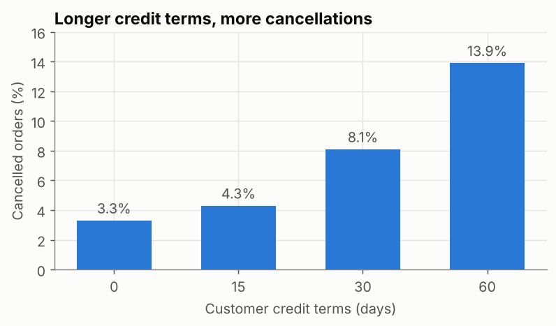
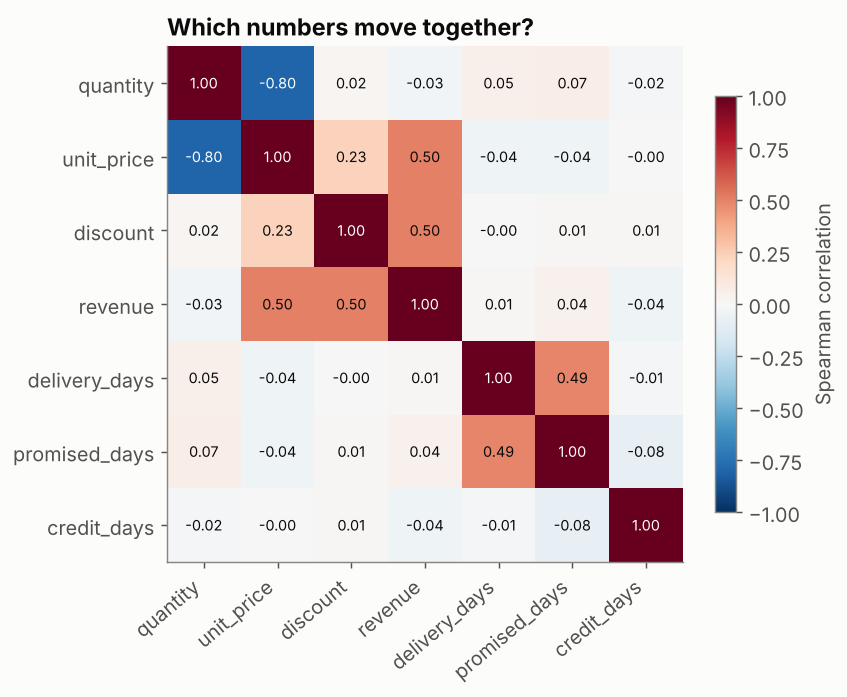
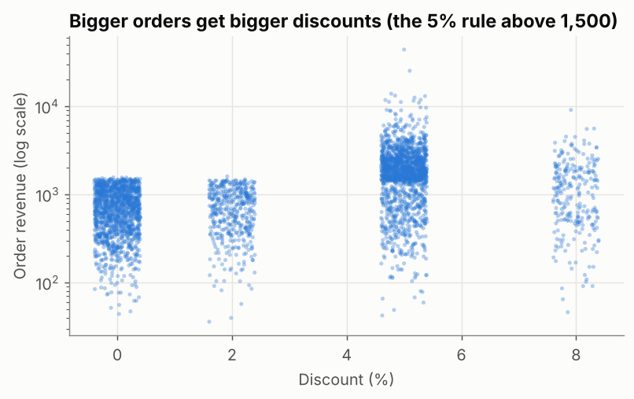

## What is it?

| Part | Question | Typical tools |
|---|---|---|
| **Relationships** | When one variable changes, does another tend to change too? | Crosstab, rate by group, correlation, scatter plot |
| **Anomalies** | Which values or periods don't fit the usual pattern, and why? | IQR rule, rolling median, robust z-score, investigation |

Both end with **judgement**: a relationship is not a cause, and an anomaly is not automatically an error.

!!! job "Why it matters at work"
    "What drives cancellations?" and "Is this spike real?" are everyday questions. Answering them well (with the right comparison, the counts behind each rate, and an explanation for every outlier) builds trust. Removing a "weird" value that turns out to be your biggest customer's real order destroys it.

The script is `10_eda_relationships_anomalies.py`. It joins `customers_2025.csv` to the orders to bring in each customer's **credit terms**.

## Relationship 1: two categories (crosstab)

Which channels does each segment use? Use **row percentages**, so segments of different sizes compare fairly:

```python
ct = pd.crosstab(df["segment"], df["channel"], normalize="index").mul(100).round(1)
print(ct)
```

```text
channel          Phone  Portal  Sales rep
segment
Garment Factory   14.7    61.4       23.8
Knitting Mill     19.7    50.1       30.2
Retailer          36.0    14.4       49.7
Trader            29.8    23.6       46.6
```

Factories mostly order through the web **portal** (61%); retailers mostly through **sales reps** and the **phone**. Keep this in mind: any "portal effect" is mixed up with "who uses the portal" (see *Traps* below).

## Relationship 2: a category and a rate

Do credit terms relate to cancellations? Show the **rate and the count** for every group:

```python
rate = df.groupby("credit_days")["cancelled"].agg(["mean", "size"])
rate["mean"] = (rate["mean"] * 100).round(1)
print(rate)
```

```text
             mean  size
credit_days
0             3.3  1353
15            4.3   880
30            8.1  1366
60           13.9   647
```



A clear, steady relationship: customers on 60-day credit cancel **4× as often** as cash customers. Every group has hundreds of orders, so it's not noise from a tiny group. It is still a **relationship, not proof of cause**: maybe riskier customers are the ones given long credit.

## Relationship 3: numbers together (correlation)

**Correlation** (from −1 to +1) measures how consistently two numbers move together. Use **Spearman** (rank-based) for skewed data like ours; Pearson assumes a straight-line relationship and is pulled around by outliers.

```python
num = net[["quantity", "unit_price", "discount", "revenue", "delivery_days", "promised_days", "credit_days"]]
corr = num.corr(method="spearman").round(2)
print(corr.loc[["revenue", "delivery_days"], ["quantity", "discount", "promised_days", "credit_days"]])
```

```text
               quantity  discount  promised_days  credit_days
revenue           -0.03       0.5           0.04        -0.04
delivery_days      0.05      -0.0           0.49        -0.01
```



How to read it, and why each number needs a business explanation:

| Pair | ρ | Explanation |
|---|---|---|
| quantity – unit_price | **−0.80** | **Product mix**: cheap trims (buttons at 0.04) are bought in thousands, fabric (3.50) in hundreds. Not "higher quantity lowers the price" |
| quantity – revenue | −0.03 | Same mix effect: across different products, quantity says little about value. Within one product it's strongly positive |
| discount – revenue | 0.50 | A **business rule**: orders above 1,500 get at least 5% |
| delivery_days – promised_days | 0.49 | Both depend on **region**: far regions are promised and get longer times |
| credit_days – anything | ≈ 0 | Correlation misses relationships with a yes/no outcome (cancellation): use rates, as above |

## Relationship 4: a scatter plot shows the shape

```python
print(net.groupby("discount")["revenue"].median().round(0))
```

```text
discount
0.00     709.0
0.02     722.0
0.05    1822.0
0.08    1141.0
Name: revenue, dtype: float64
```



The scatter reveals what the 0.50 hides: a **hard cut at 1,500**. Discounts don't *cause* big orders; the discount policy is *triggered by* big orders. Reading this the wrong way round ("give discounts to grow orders") would be an expensive mistake.

## Traps when reading relationships

| Trap | Example in our data | Defence |
|---|---|---|
| **Confounding** (a third variable drives both) | Portal orders may look different only because factories use the portal | Compare within groups (portal vs not, *per segment*) |
| **Reverse causation** | Big orders → discount, not discount → big orders | Ask which came first; check the business rules |
| **Mix effects** | quantity vs price is −0.80 across products | Analyse within one product or category |
| **Small groups** | A 50% rate from 4 orders | Always show counts next to rates |
| **Correlation = 0 means no relationship** | Credit vs cancellation | Correlation only sees steady, monotonic patterns between numbers |

## Anomalies 1: unusually large orders (IQR rule per group)

A value is flagged when it is far above the **interquartile range (IQR)** of its own group. Using each segment's own range avoids flagging every factory order just because factories are big.

```python
def iqr_flags(s: pd.Series) -> pd.Series:
    q1, q3 = s.quantile([0.25, 0.75])
    return s > q3 + 3 * (q3 - q1)


net["unusual"] = net.groupby("segment")["revenue"].transform(iqr_flags)
print(net["unusual"].sum(), "unusually large orders")
print(net.loc[net["unusual"]].nlargest(5, "revenue")[["order_id", "segment", "product", "quantity", "revenue"]])
```

```text
57 unusually large orders
      order_id          segment        product  quantity   revenue
3824     13825  Garment Factory  Sewing Thread     54776  44127.55
2934     12935  Garment Factory     Denim 12oz      5128  25381.04
1550     11551    Knitting Mill  Sewing Thread     16968  13927.33
2967     12968  Garment Factory   Cotton Twill      4032  13253.18
3269     13270  Garment Factory   Viscose Yarn      4176  13091.76
```

`3 × IQR` flags only extreme values (1.5 × IQR is the usual box-plot whisker). Prices on these orders are normal; only the quantity is large. They look like **genuine bulk orders**: keep them, and report medians so they don't distort "typical" figures. (The impossible prices like 350 per metre were *errors*, and the Cleaning lesson removed them.)

## Anomalies 2: unusual days (rolling median)

A fixed threshold fails when the level changes through the year. Instead, compare each day with the **rolling median of similar days** around it (Saturdays are half days, so they're compared with other Saturdays):

```python
daily = net.set_index("order_date").resample("D")["order_id"].count()
daily = daily[daily.index.dayofweek != 4]                          # skip Fridays (weekend)
is_saturday = daily.index.dayofweek == 5
normal = daily.groupby(is_saturday).transform(lambda s: s.rolling(15, center=True, min_periods=5).median())
ratio = daily / normal
low_days = ratio[ratio < 0.35]
print(f"{len(low_days)} unusually quiet days (below 35% of the rolling median for that kind of day):")
print([d.strftime("%d %b") for d in low_days.index])
```

```text
15 unusually quiet days (below 35% of the rolling median for that kind of day):
['18 Jan', '29 Mar', '30 Mar', '31 Mar', '01 Apr', '02 Apr', '05 Apr', '13 Apr', '05 Jun', '07 Jun', '08 Jun', '09 Jun', '10 Jun', '11 Jun', '12 Jun']
```

13 of the 15 days fall in the two **Eid holiday** periods: anomalies with a known cause (an *event*, not an error). Two (18 January and 13 April) have no explanation in our calendar. Those are the ones to ask the sales team about.

## Error, event or outlier?

| Type | Example | What to do |
|---|---|---|
| **Data error** | Unit price 350 instead of 3.50; negative quantity | Fix with a documented rule, or remove and report |
| **Known event** | Eid week, a system outage, a price change | Keep; annotate charts; exclude from "normal" baselines if needed |
| **Genuine outlier** | A 44,000 bulk order | Keep; use robust statistics; mention it in findings |
| **Unexplained** | 18 January | Investigate before deciding |

## Common mistakes

| Mistake | What happens | Fix |
|---|---|---|
| Rates without counts | Tiny groups look dramatic | Show `size` next to every rate |
| Pearson on skewed data | Outliers drive the number | Spearman, or log-transform first |
| Reading correlation as cause | Wrong actions (discounts "to grow orders") | Look for confounders, rules and timing |
| Deleting all outliers | Real big customers disappear | Classify first: error, event, outlier, unexplained |
| One global threshold for anomalies | Seasons flagged as anomalies | Compare with a rolling or group baseline |

## Try it yourself

**Task:** Is there a relationship between **region** and delivery days? Show the median, mean and maximum per region, then list the three slowest deliveries. Are those anomalies, and what would you check?

<details markdown="1">
<summary>Show the solution</summary>

```python
by_region = net.groupby("region")["delivery_days"].agg(["median", "mean", "max"]).round(2)
print(by_region.sort_values("mean"))
print(net.nlargest(3, "delivery_days")[["order_id", "order_date", "region", "delivery_days", "promised_days"]])
```

```text
             median  mean   max
region
Dhaka           2.0  2.38   7.0
Narayanganj     3.0  2.80  10.0
Gazipur         3.0  2.87   9.0
Chattogram      4.0  4.39  14.0
Khulna          5.0  5.26  17.0
      order_id order_date  region  delivery_days  promised_days
3592     13593 2025-11-12  Khulna           17.0              6
3265     13266 2025-10-23  Khulna           16.0              6
3375     13376 2025-10-29  Khulna           15.0              6
```

A strong relationship: Khulna takes more than twice as long as Dhaka. The three slowest are all Khulna orders in October–November, the busiest season. They're real late deliveries (nearly 3× the promised 6 days) rather than data errors. Check carrier records for those weeks before deciding whether it's a capacity problem.
</details>

## Quick quiz

<div class="quiz-q" markdown="1">
1\. Quantity and unit price have a correlation of −0.80. What's the most likely explanation here?

1. Customers get lower prices when they buy more of the same product
2. Product mix: cheap items are bought in large quantities, expensive ones in small
3. The data has errors

<details markdown="1"><summary>Show answer</summary>
**B.** Always look for a business explanation before interpreting a correlation.
</details>
</div>

<div class="quiz-q" markdown="1">
2\. Why compare each day with a rolling median instead of one yearly threshold?

1. It's faster
2. The normal level changes through the year, so a fixed line flags whole seasons
3. Rolling medians remove all anomalies

<details markdown="1"><summary>Show answer</summary>
**B.**
</details>
</div>

<div class="quiz-q" markdown="1">
3\. You find a 44,000 order with a normal unit price and a very large quantity. What do you do?

1. Delete it, because it's an outlier
2. Keep it as a genuine outlier, use robust statistics, and mention it in the findings
3. Replace it with the mean

<details markdown="1"><summary>Show answer</summary>
**B.**
</details>
</div>

## Summary

- **Two categories:** crosstab with row percentages. **Category and outcome:** rate *and* count per group. **Two numbers:** Spearman correlation plus a scatter plot.
- Explain every relationship with the business (mix, rules, region), and watch for **confounding** and **reverse causation**.
- Find anomalies against the right baseline (IQR within group, rolling median of similar days).
- Classify each anomaly: **error, event, genuine outlier or unexplained**, and act accordingly.

!!! job "Job-ready check"
    **Interview question:** *"You find that customers with discounts place much larger orders. Should we give more discounts?"*

    **Strong answer:** "Not on that evidence. In this data the discount policy is triggered by order size (5% above 1,500), so large orders cause discounts, not the reverse. To learn whether discounts *increase* order size, we'd need an experiment, for example randomly offering a discount to some comparable customers, which is the A/B testing module."

    **Mini project:** Write a short "drivers of cancellation" note: rate and count by credit terms, segment and channel, one chart, and three sentences on which relationships might be confounded.
