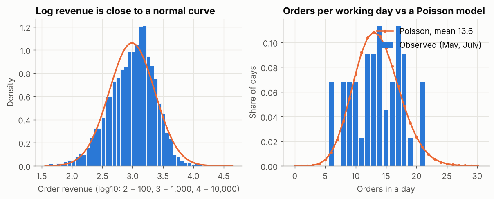

## What is it?

| Idea | Question it answers | Main measures |
|---|---|---|
| **Central tendency** | What's a typical value? | Mean, median, mode, trimmed mean |
| **Spread (variance)** | How different are the values from each other? | Range, IQR, variance, standard deviation, CV |
| **Distribution** | What shape do the values follow, so I can model and predict? | Normal, log-normal, Poisson, binomial |

!!! job "Why it matters at work"
    "Average order value" is reported in every sales meeting, often wrongly for skewed data. Knowing which centre and spread to report, and which distribution fits (counts per day, yes/no outcomes, money amounts), lets you set realistic targets, spot unusual values and plan capacity. These basics come up in almost every data science interview.

The script is `11_stats_center_spread.py`. `net` = orders that weren't cancelled; `rev` = their revenue.

## Part 1: central tendency

```python
from scipy import stats

print("mean   ", round(rev.mean(), 2))
print("median ", round(rev.median(), 2))
print("trimmed mean (5% each end)", round(stats.trim_mean(rev, 0.05), 2))
print("mode of discount:", net["discount"].mode().tolist())
```

```text
mean    1382.38
median  1060.22
trimmed mean (5% each end) 1224.96
mode of discount: [0.05]
```

| Measure | What it is | Use it when |
|---|---|---|
| **Mean** | Sum ÷ count | Data is roughly symmetric, or you need totals (mean × count = total revenue) |
| **Median** | The middle value | Data is skewed or has outliers: "a typical order" |
| **Trimmed mean** | Mean after dropping the top and bottom 5% | You want a mean that ignores extremes |
| **Mode** | The most common value | Categories or a few repeated values (the most common discount is 5%) |

Order revenue is right-skewed, so the three answers differ by 30%. For "typical order value", report the **median, 1,060**. For forecasting **total** revenue, you still need the mean.

## Part 2: spread

```python
q1, q3 = rev.quantile([0.25, 0.75])
spread = pd.Series({
    "range": rev.max() - rev.min(),
    "IQR": q3 - q1,
    "variance": rev.var(),          # sample variance (divides by n - 1)
    "std": rev.std(),
    "CV": rev.std() / rev.mean(),
}).round(2)
print(spread)
```

```text
range         44091.51
IQR            1222.69
variance    2157984.61
std            1469.01
CV                1.06
dtype: float64
```

- **Variance** is the average squared distance from the mean. Its unit is "revenue squared", which is hard to read, so we use its square root, the **standard deviation (std)**, in the original unit.
- **IQR** (75th − 25th percentile) is the spread of the middle half: robust to the 44,000 outlier, unlike the range.
- **CV** (coefficient of variation = std ÷ mean) compares spread across things with different units or sizes. Above 1, as here, means very uneven values.
- pandas' `.var()` and `.std()` divide by **n − 1** (sample statistics), NumPy's `np.std` divides by **n** by default. Tiny difference for big data, but know which one you report.

Centre and spread together describe a region's delivery performance:

```python
dd = net[net["status"] == "Delivered"]
two = dd[dd["region"].isin(["Dhaka", "Khulna"])].groupby("region")["delivery_days"].agg(["mean", "std", "min", "max"])
print(two.round(2))
```

```text
        mean   std  min   max
region
Dhaka   2.38  1.22  1.0   7.0
Khulna  5.26  2.64  1.0  17.0
```

Khulna is not only slower on average; it's also **less predictable** (std 2.64 vs 1.22). For customers, unpredictability is often worse than slowness, which is why delivery promises should consider spread, not just the mean.

## Part 3: four distributions you'll meet constantly

| Distribution | Describes | Example here | Key parameter(s) |
|---|---|---|---|
| **Normal** | Symmetric values around a mean | Log of order revenue; measurement errors; averages of many values | mean, std |
| **Log-normal** | Positive, right-skewed amounts whose log is normal | Order revenue, salaries, web session times | mean and std of the log |
| **Poisson** | Counts of events in a fixed period | Orders per working day | λ (average count) |
| **Binomial** | Number of "yes" in *n* independent yes/no trials | Cancellations in a batch of orders | n, p |

### Normal and log-normal

```python
for name, x in [("revenue", rev), ("log revenue", np.log(rev))]:
    within_1sd = ((x - x.mean()).abs() <= x.std()).mean()
    print(f"{name:12s} skew {stats.skew(x):5.2f} | share within 1 std of mean: {within_1sd:.1%} (normal: 68.3%)")
```

```text
revenue      skew  9.27 | share within 1 std of mean: 91.1% (normal: 68.3%)
log revenue  skew -0.34 | share within 1 std of mean: 69.2% (normal: 68.3%)
```

A normal distribution has about **68%** of values within 1 std of the mean and **95%** within 2. Raw revenue breaks that rule; **log revenue** follows it closely. So order revenue is approximately **log-normal**: work on the log scale when you need "normal" methods.

### Poisson: counts per day

```python
weekday = net[net["order_date"].dt.dayofweek.isin([0, 1, 2, 3, 6])]   # Sunday–Thursday working days
per_day = weekday.groupby("order_date").size()
per_day = per_day[per_day.index.month.isin([5, 7])]   # two steady months, no Eid: May, July
lam = per_day.mean()
print(f"May + July working days: {len(per_day)}, mean orders/day {lam:.2f}, variance {per_day.var():.2f}")
print("P(a working day has 20+ orders), Poisson model:", round(1 - stats.poisson.cdf(19, lam), 3),
      "| observed:", round((per_day >= 20).mean(), 3))
```

```text
May + July working days: 44, mean orders/day 13.57, variance 17.18
P(a working day has 20+ orders), Poisson model: 0.06 | observed: 0.068
```



The Poisson model predicts a 20+ order day on about **6%** of working days; we observed 6.8%. That's useful for **capacity planning**: "plan staff for 20 orders on roughly 1 day in 15". In a Poisson distribution the variance equals the mean; here it's a bit higher (17.2 vs 13.6), which is common in real data (**overdispersion**: some days are busier for reasons the model doesn't know).

### Binomial: yes/no outcomes

```python
p_cancel = (orders["status"] == "Cancelled").mean()
print(f"cancellation rate {p_cancel:.3f}; in a batch of 50 orders, P(5 or more cancelled) =",
      round(1 - stats.binom.cdf(4, 50, p_cancel), 3))
```

```text
cancellation rate 0.067; in a batch of 50 orders, P(5 or more cancelled) = 0.239
```

With a 6.7% cancellation rate, a batch of 50 orders has **5 or more cancellations about 1 time in 4** by chance alone. So "5 cancellations this week!" is not, by itself, a sign of a problem. The binomial gives you the yardstick.

## z-scores: "how many standard deviations away?"

A **z-score** = (value − mean) ÷ std. On a normal distribution, |z| > 3 is rare (about 3 in 1,000). Only use z-scores where the data is roughly normal, or on a transformed scale (see *Try it yourself*).

## Common mistakes

| Mistake | What happens | Fix |
|---|---|---|
| Reporting only the mean of skewed data | "Typical" value overstated | Median (and percentiles) for typical; mean for totals |
| Reporting a centre without a spread | Can't tell steady from erratic | Always pair them: median + IQR, or mean + std |
| Assuming everything is normal | Wrong probabilities and false outliers | Check shape; use log scale, Poisson or binomial as appropriate |
| Treating normal chance variation as a signal | Panic over 5 cancellations in 50 | Compare with the binomial/Poisson range first |
| Mixing sample and population std | Small, confusing differences | Know whether you divide by n − 1 (pandas) or n (NumPy default) |

## Try it yourself

**Task:** How unusual is the 44,127.55 order? Calculate its z-score on the raw revenue scale and on the log10 scale. Which one is meaningful, and why?

<details markdown="1">
<summary>Show the solution</summary>

```python
big = 44127.55
z_raw = (big - rev.mean()) / rev.std()
z_log = (np.log10(big) - np.log10(rev).mean()) / np.log10(rev).std()
print(f"z on the raw scale: {z_raw:.1f} | z on the log scale: {z_log:.1f}")
```

```text
z on the raw scale: 29.1 | z on the log scale: 4.4
```

The **log-scale z (4.4)** is the meaningful one, because log revenue is close to normal. It says the order is very rare (beyond 4 std) but not absurd. The raw-scale 29.1 is misleading: raw revenue isn't normal, so its std doesn't describe "typical" distances.
</details>

## Quick quiz

<div class="quiz-q" markdown="1">
1\. Which measure of centre is best for "a typical order value" in right-skewed data?

1. Mean
2. Median
3. Range

<details markdown="1"><summary>Show answer</summary>
**B.**
</details>
</div>

<div class="quiz-q" markdown="1">
2\. "Number of orders received per day" usually follows which distribution?

1. Normal
2. Poisson
3. Binomial

<details markdown="1"><summary>Show answer</summary>
**B.** Counts of events in a fixed period. Binomial is for "yes" counts out of a known number of trials.
</details>
</div>

<div class="quiz-q" markdown="1">
3\. Two regions have the same mean delivery time, but region B has double the standard deviation. What does that mean for customers?

1. Nothing: the means are equal
2. Region B's delivery times are less predictable
3. Region B is faster

<details markdown="1"><summary>Show answer</summary>
**B.**
</details>
</div>

## Summary

- **Centre:** mean (for totals), median (typical value in skewed data), trimmed mean, mode.
- **Spread:** IQR (robust), standard deviation (same unit as the data), CV (compare across scales). Always report centre *with* spread.
- **Distributions:** normal (symmetric), log-normal (money amounts), Poisson (counts per period), binomial (yes/no out of n).
- Use them to ask "is this unusual, or normal variation?" before reacting.

!!! job "Job-ready check"
    **Interview question:** *"Our average order value went up 10% this month. Is that good news?"*

    **Strong answer:** "Maybe. Order values are skewed, so a few very large orders can move the mean a lot. I'd check the median and percentiles, how many large orders there were, and whether the number of orders changed. Then I'd compare the change with normal month-to-month variation before calling it a trend."

    **Mini project:** For each customer segment, report median and mean revenue, IQR, std and CV in one table, plus one sentence per segment on how predictable its orders are.
