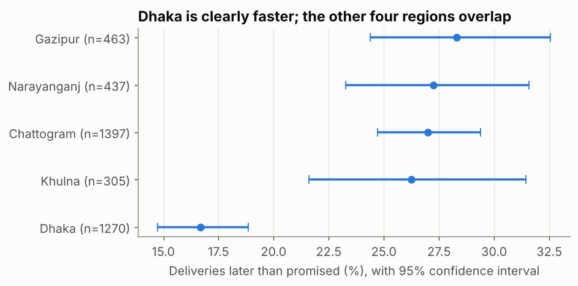

## What is it?

- **Correlation** is one number (−1 to +1) for how consistently two variables move together. **Pearson r** measures straight-line relationships; **Spearman ρ** (rho) works on ranks, so it handles skew and outliers.
- A **confidence interval (CI)** gives a range of plausible values for something you estimated from a sample: "mean delivery time 5.26 days, 95% CI 4.96 to 5.55".

!!! job "Why it matters at work"
    A single number without uncertainty invites over-reaction: "Khulna's late rate is 26%, Gazipur's is 28%, so Gazipur is worse!" Confidence intervals show when a difference is real and when it's noise, and they're expected in any serious analysis, A/B test or model evaluation.

The script is `12_stats_correlation_ci.py`.

## Part 1: correlation done right

### Within one product, quantity and revenue are tightly linked

The EDA lesson found quantity vs revenue ≈ 0 across all products (a mix effect). Within **one** product it's a different story:

```python
twill = net[net["product"] == "Cotton Twill"]
r, p_r = stats.pearsonr(twill["quantity"], twill["revenue"])
rho, p_rho = stats.spearmanr(twill["quantity"], twill["revenue"])
print(f"Cotton Twill orders: {len(twill)} | Pearson r = {r:.3f} (p = {p_r:.1e}) | Spearman rho = {rho:.3f}")
print(f"r squared = {r**2:.3f}: quantity explains {r**2:.1%} of the variation in revenue")
```

```text
Cotton Twill orders: 348 | Pearson r = 0.999 (p = 0.0e+00) | Spearman rho = 0.999
r squared = 0.998: quantity explains 99.8% of the variation in revenue
```

- **r²** (r squared) is the share of the variation in one variable that a straight line on the other explains.
- The p-value tests "is the true correlation zero?". With hundreds of rows, even tiny correlations get tiny p-values, so **judge the size, not just the p-value**.

### One extreme point can invent a correlation

```python
rng = np.random.default_rng(7)
x = rng.normal(0, 1, 30)
y = rng.normal(0, 1, 30)
print(f"30 random points:      Pearson {stats.pearsonr(x, y)[0]:.2f} | Spearman {stats.spearmanr(x, y)[0]:.2f}")
x2, y2 = np.append(x, 8), np.append(y, 8)
print(f"plus one extreme point: Pearson {stats.pearsonr(x2, y2)[0]:.2f} | Spearman {stats.spearmanr(x2, y2)[0]:.2f}")
```

```text
30 random points:      Pearson -0.12 | Spearman -0.14
plus one extreme point: Pearson 0.72 | Spearman -0.03
```

Thirty random, unrelated points, plus **one** outlier, and Pearson jumps to 0.72. Spearman barely moves. Always **plot** before you believe a correlation, and prefer Spearman for skewed business data.

| Size of \|r\| | Rough description |
|---|---|
| < 0.1 | Negligible |
| 0.1–0.3 | Weak |
| 0.3–0.5 | Moderate |
| > 0.5 | Strong |

These bands are only a guide: in some fields 0.2 matters a lot; in others 0.8 is disappointing.

## Part 2: confidence intervals

### Why an interval?

Our 2025 orders are a **sample** of how the business behaves. Next year's orders will differ a little. A **95% CI** is built so that, if we repeated the sampling many times, about 95% of such intervals would contain the true value. In practice: *a range of plausible values*. Its width depends on the **spread** of the data and the **sample size** (the standard error, std ÷ √n).

### CI for a mean (t-interval)

```python
khulna = delivered.loc[delivered["region"] == "Khulna", "delivery_days"]
m, se = khulna.mean(), stats.sem(khulna)
lo, hi = stats.t.interval(0.95, df=len(khulna) - 1, loc=m, scale=se)
print(f"Khulna delivery days: n = {len(khulna)}, mean {m:.2f}, 95% CI {lo:.2f} to {hi:.2f}")
```

```text
Khulna delivery days: n = 305, mean 5.26, 95% CI 4.96 to 5.55
Only 30 orders:       mean 5.43, 95% CI 4.43 to 6.43
```

With 305 orders the interval is ±0.3 days; with only 30 it's ±1 day, about **3× wider** (√(305/30) ≈ 3.2). More data, narrower interval.

### CI for a proportion (Wilson)

```python
late = delivered["delivery_days"] > delivered["promised_days"]
res = stats.binomtest(int(late.sum()), len(late))
ci = res.proportion_ci(confidence_level=0.95, method="wilson")
print(f"Late deliveries: {late.sum()} of {len(late)} = {late.mean():.2%}, 95% CI {ci.low:.2%} to {ci.high:.2%}")
```

```text
Late deliveries: 919 of 3872 = 23.73%, 95% CI 22.42% to 25.10%
```

Almost **1 in 4** deliveries miss the promised date. The **Wilson** method works well even for small samples or rates near 0% or 100%, where the simple "p ± 1.96 × SE" formula breaks down.

### Compare groups with their CIs

```text
     region    n  late_pct   lo   hi
      Dhaka 1270      16.7 14.7 18.8
     Khulna  305      26.2 21.6 31.4
 Chattogram 1397      27.0 24.7 29.4
Narayanganj  437      27.2 23.3 31.6
    Gazipur  463      28.3 24.4 32.6
```



- **Dhaka is clearly better**: its interval (14.7–18.8%) doesn't overlap any other region's.
- The other four (26–28%) **overlap heavily**: ranking them would be over-reading noise. Khulna's interval is widest because it has the fewest deliveries.
- Overlapping intervals don't strictly *prove* "no difference" (the A/B testing module shows the proper test), but non-overlap is a strong sign of a real one.

### CI for anything: the bootstrap

There's no simple formula for the CI of a **median**. The **bootstrap** resamples the data with replacement thousands of times, recomputes the statistic each time, and takes the middle 95% of the results:

```python
rev = net["revenue"].to_numpy()
boot = np.array([np.median(rng.choice(rev, size=len(rev), replace=True)) for _ in range(5000)])
print(f"median order value {np.median(rev):.0f}, bootstrap 95% CI {np.percentile(boot, 2.5):.0f} "
      f"to {np.percentile(boot, 97.5):.0f}")
```

```text
median order value 1060, bootstrap 95% CI 1023 to 1099
```

The bootstrap works for medians, percentiles, ratios and model scores. (`scipy.stats.bootstrap` does the same with better methods built in.)

## How to report it

> Median order value was **1,060** (95% CI 1,023–1,099). **23.7%** of deliveries were late (95% CI 22.4–25.1%). Dhaka's late rate (16.7%) is clearly lower than the other regions (26–28%, which can't be separated with this data).

## Common mistakes

| Mistake | What happens | Fix |
|---|---|---|
| Believing a correlation without a plot | One outlier creates a "strong" relationship | Scatter plot + Spearman |
| Judging by p-value alone | Trivial correlations look "significant" with big data | Report the size (r, r²) and a CI |
| "95% chance the true value is in *this* interval" | A common, technically wrong wording | Say "a range of plausible values"; the 95% is about the method |
| Ranking groups whose CIs overlap | Acting on noise | Show CIs; test the difference properly |
| Normal-formula CIs for skewed medians or tiny samples | Wrong intervals | Bootstrap; Wilson for proportions |

## Try it yourself

**Task:** Compute a 95% CI for the **mean** order revenue of Garment Factories and of Retailers. How wide is each, and why is one wider relative to its mean?

<details markdown="1">
<summary>Show the solution</summary>

```python
for seg in ["Garment Factory", "Retailer"]:
    s = net.loc[net["segment"] == seg, "revenue"]
    lo_s, hi_s = stats.t.interval(0.95, df=len(s) - 1, loc=s.mean(), scale=stats.sem(s))
    print(f"{seg:16s} n={len(s):4d} mean {s.mean():7.0f}  95% CI {lo_s:7.0f} to {hi_s:7.0f}")
```

```text
Garment Factory  n=2594 mean    1632  95% CI    1570 to    1695
Retailer         n= 256 mean     324  95% CI     282 to     367
```

Garment factories: ±63 around 1,632 (about ±4%). Retailers: ±43 around 324 (about ±13%). The retailer interval is relatively **3× wider** because there are 10× fewer retailer orders. The two intervals are nowhere near each other, so the difference between segments is clearly real.
</details>

## Quick quiz

<div class="quiz-q" markdown="1">
1\. 30 unrelated points plus one extreme point give Pearson 0.72 and Spearman −0.03. What should you conclude?

1. There's a strong relationship
2. The outlier creates the Pearson value; there's no real relationship
3. Spearman is broken

<details markdown="1"><summary>Show answer</summary>
**B.**
</details>
</div>

<div class="quiz-q" markdown="1">
2\. You quadruple the sample size. Roughly what happens to the width of a CI for the mean?

1. It halves
2. It quarters
3. It stays the same

<details markdown="1"><summary>Show answer</summary>
**A.** Width shrinks with √n: √4 = 2.
</details>
</div>

<div class="quiz-q" markdown="1">
3\. Which method gives a CI for a median without a formula?

1. The t-interval
2. The bootstrap
3. Pearson correlation

<details markdown="1"><summary>Show answer</summary>
**B.**
</details>
</div>

## Summary

- **Pearson** = straight-line relationships; **Spearman** = rank-based, robust. Plot first; report size (r, r²), not just p-values.
- A **95% CI** is a range of plausible values; width depends on spread and √n.
- Means: t-interval. Proportions: Wilson. Anything else (medians, percentiles): **bootstrap**.
- Compare groups with their CIs before ranking them.

!!! job "Job-ready check"
    **Interview question:** *"Region A's late rate is 26%, region B's is 28%. Is B worse?"*

    **Strong answer:** "Not necessarily. I'd put a confidence interval on each rate: with a few hundred deliveries each, the intervals are about ±4 percentage points and overlap heavily, so the 2-point gap is within noise. I'd say they perform similarly, and a formal two-proportion test or more data would be needed to separate them."

    **Mini project:** Make a one-page "KPIs with uncertainty" table: median order value, cancellation rate and late-delivery rate, each overall and per segment, with 95% CIs (bootstrap for medians, Wilson for rates).
