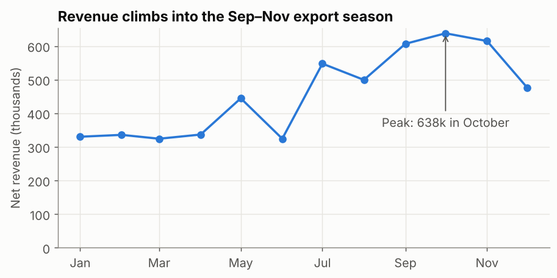
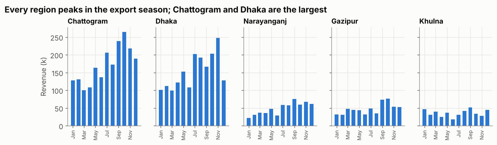
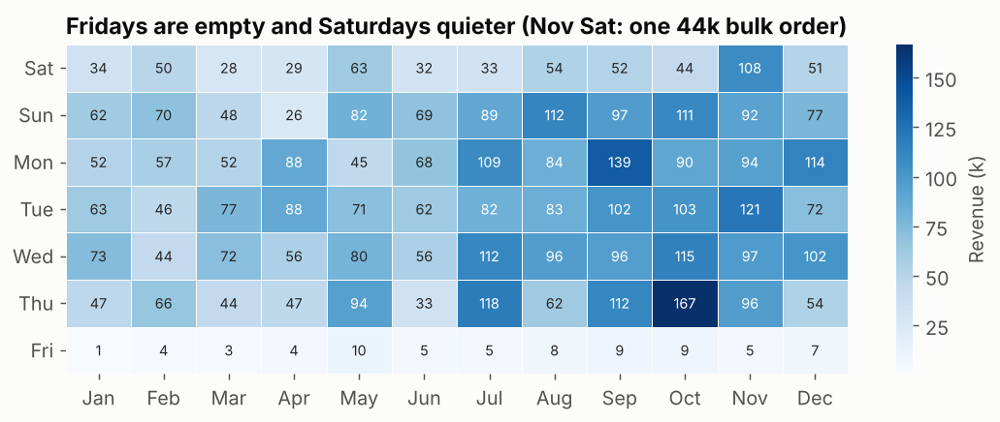

## What is it?

| Library | Strength | Use it for |
|---|---|---|
| **matplotlib** | Total control of every element | Report charts, custom layouts, annotations |
| **seaborn** | Statistical charts from a DataFrame in one call, built on matplotlib | Comparisons with CIs, distributions, heatmaps |

!!! job "Why it matters at work"
    Notebooks, reports and model evaluations are full of Python charts. A clear chart with an action title gets read; a default chart with a legend of five rainbow colours gets skipped. Python charting is also how you show EDA and model results in interviews and portfolios.

The script is `15_viz_matplotlib_seaborn.py`. Every chart uses `apply_style()` and `save()` from `chart_style.py`.

## Part 1: the matplotlib model — Figure and Axes

- A **Figure** is the whole image. An **Axes** is one chart inside it (with its x-axis and y-axis).
- `fig, ax = plt.subplots()` creates both. Then you call methods **on the Axes**: `ax.plot`, `ax.bar`, `ax.set_title`…

```python
monthly = net.groupby("month")["revenue"].sum() / 1000
fig, ax = plt.subplots(figsize=(8, 3.6))                 # Figure = the canvas, Axes = one chart
ax.plot(monthly.index, monthly.values, marker="o", color=PALETTE[0])
ax.set_title("Revenue climbs into the Sep–Nov export season")
ax.set_ylabel("Net revenue (thousands)")
ax.set_ylim(0, None)                                     # bars and totals start at zero
peak = monthly.idxmax()
ax.annotate(f"Peak: {monthly.max():.0f}k in {peak:%B}", (peak, monthly.max()), xytext=(0, -85), ha="center",
            textcoords="offset points", arrowprops={"arrowstyle": "->", "color": INK_2}, color=INK_2)
ax.xaxis.set_major_formatter(plt.matplotlib.dates.DateFormatter("%b"))
save(fig, "viz_monthly_line.png")
```



Four habits in eight lines:

1. **Action title** that states the finding.
2. **Units** in the axis label ("thousands").
3. **Y-axis from zero** for totals, so differences aren't exaggerated.
4. **One annotation** pointing at what matters.

!!! tip "Two styles"
    You'll also see `plt.plot(...)`, `plt.title(...)` (the "pyplot" style). It's fine for quick looks, but `fig, ax` scales to several charts and is what the docs recommend for anything you keep.

## Part 2: small multiples

When five lines on one chart become spaghetti, give each series its own small chart with the **same y-axis**:

```python
regions = net.groupby("region")["revenue"].sum().sort_values(ascending=False).index
fig, axes = plt.subplots(1, len(regions), figsize=(12, 2.8), sharey=True)
for ax, region in zip(axes, regions):
    m = net[net["region"] == region].groupby("month")["revenue"].sum() / 1000
    ax.bar(m.index, m.values, width=20, color=PALETTE[0])
    ax.set_title(region, fontsize=11)
```



`sharey=True` makes the panels comparable at a glance: Chattogram and Dhaka are the big regions, and every region has the same seasonal shape.

## Part 3: seaborn — statistics built in

Seaborn takes a DataFrame and column names, and does the grouping and statistics for you.

```python
delivered["late"] = delivered["delivery_days"] > delivered["promised_days"]
order_regions = delivered.groupby("region")["late"].mean().sort_values().index

fig, axes = plt.subplots(1, 2, figsize=(12, 3.8))
sns.barplot(data=delivered, x="late", y="region", order=order_regions, errorbar=("ci", 95), color=PALETTE[0],
            ax=axes[0])                                          # mean of True/False = late rate, with 95% CI
sns.boxplot(data=delivered, x="delivery_days", y="region", order=order_regions, color=PALETTE[0],
            fliersize=2, ax=axes[1])
```


- `sns.barplot` computes the **mean per group** (the mean of True/False is a rate) and draws a **95% confidence interval** (bootstrapped), the same picture as the Statistics lesson, in one call.
- `sns.boxplot` shows the whole distribution per group.
- Passing `ax=` puts seaborn charts into your own matplotlib layout, so you can mix both libraries.

### Heatmap: two categories × one number

```python
grid = net.pivot_table(index="weekday", columns=net["order_date"].dt.month, values="revenue", aggfunc="sum") / 1000
sns.heatmap(grid, cmap="Blues", annot=True, fmt=".0f", cbar_kws={"label": "Revenue (k)"}, ax=ax)
```

```text
order_date   Sep    Oct    Nov
weekday
Fri          9.0    9.0    5.0
Sat         52.0   44.0  108.0
Sun         97.0  111.0   92.0
```



Fridays are empty (the weekly holiday) and Saturdays quieter. One cell breaks the pattern: **Saturdays in November (108k)**. Check before explaining: it contains the single 44,127 bulk order from 29 November. Heatmaps are great at revealing such exceptions; annotations (`annot=True`) give the exact values.

## Choosing the chart

| Question | Chart |
|---|---|
| Change over time | Line (few series) or small multiples (many) |
| Compare categories | Sorted horizontal bars |
| Rate per group with uncertainty | Bars or dots with CIs (`sns.barplot`, `sns.pointplot`) |
| Distribution | Histogram; box plots to compare groups |
| Two categories × a number | Heatmap |
| Two numbers | Scatter (log scale for money) |
| Share of a whole over time | 100% stacked bars (few categories) |

## Common mistakes

| Mistake | What happens | Fix |
|---|---|---|
| Bar charts not starting at 0 | Small differences look huge | `ax.set_ylim(0, None)` for bars and totals |
| Five+ colours and a legend | Readers match colours back and forth | Small multiples, or highlight one series with direct labels |
| Descriptive titles ("Revenue by month") | The point is left to the reader | Action titles |
| Default figure size and dpi | Blurry or cramped images | `figsize=` and `savefig(dpi=130, bbox_inches="tight")` |
| Red/green as the only signal | Unreadable for colour-blind readers | Colour-blind-safe palette, plus labels |

## Try it yourself

**Task:** Make a **100% stacked bar chart** of revenue share by category (Fabric, Yarn, Trims) for each month. Is the product mix stable through the year?

<details markdown="1">
<summary>Show a hint</summary>

Pivot to month × category, divide each row by its total, then draw one `ax.bar` per category with `bottom=` set to the running total of the previous categories.
</details>

<details markdown="1">
<summary>Show the solution</summary>

```python
share = net.pivot_table(index="month", columns="category", values="revenue", aggfunc="sum")
share = share.div(share.sum(axis=1), axis=0) * 100
fig, ax = plt.subplots(figsize=(9, 3.4))
bottom = 0
for i, cat in enumerate(["Fabric", "Yarn", "Trims"]):
    ax.bar(share.index, share[cat], bottom=bottom, width=20, color=PALETTE[i], label=cat)
    bottom = bottom + share[cat]
ax.set_title("The product mix is stable all year")
ax.set_ylabel("Share of revenue (%)")
ax.legend(ncol=3, loc="upper left", bbox_to_anchor=(0, -0.12))
save(fig, "viz_mix_stacked.png")
print(share.round(1).agg(["min", "max"]))
```

```text
category  Fabric  Trims  Yarn
min         37.7   12.7  36.4
max         47.5   21.2  46.5
```

Fairly stable: Fabric and Yarn each stay between about 36% and 48% of monthly revenue, Trims between 13% and 21%. The seasonal peak is driven by volume, not by a change in what customers buy.
</details>

## Quick quiz

<div class="quiz-q" markdown="1">
1\. In `fig, ax = plt.subplots()`, what is `ax`?

1. The whole image
2. One chart (with its axes) inside the figure
3. The x-axis only

<details markdown="1"><summary>Show answer</summary>
**B.**
</details>
</div>

<div class="quiz-q" markdown="1">
2\. What does `sharey=True` do in small multiples?

1. Uses the same y-axis scale on every panel, so they can be compared
2. Shares colours between panels
3. Hides the y-axis

<details markdown="1"><summary>Show answer</summary>
**A.**
</details>
</div>

<div class="quiz-q" markdown="1">
3\. Which seaborn chart gives a mean per group with a confidence interval in one call?

1. `sns.heatmap`
2. `sns.barplot`
3. `sns.boxplot`

<details markdown="1"><summary>Show answer</summary>
**B.**
</details>
</div>

## Summary

- matplotlib: `fig, ax = plt.subplots()`, then methods on `ax`; add an action title, units, a zero baseline and one annotation.
- Use **small multiples** (`sharey=True`) instead of many-coloured spaghetti charts.
- seaborn: statistical charts from a DataFrame (`barplot` with CIs, `boxplot`, `heatmap`), placed into your own layout with `ax=`.
- Pick the chart by the question; check exceptions (like November Saturdays) before explaining them.

!!! job "Job-ready check"
    **Interview question:** *"How do you decide which chart to use?"*

    **Strong answer:** "I start from the question and the message: trends over time get a line chart, comparisons get sorted bars, distributions get histograms or box plots, and rates per group get dots or bars with confidence intervals. Then I remove anything that doesn't support the message: a clear action title, units, a zero baseline for totals, and at most one highlight colour."

    **Mini project:** Create a 2×2 figure for `orders_2025.csv`: monthly revenue (line), revenue by segment (sorted bars), order-value distribution (log histogram) and late rate by region (dots with CIs), each with an action title.
