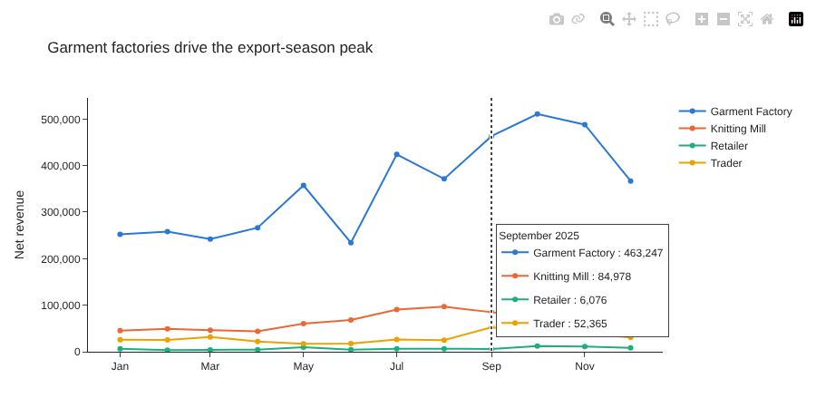
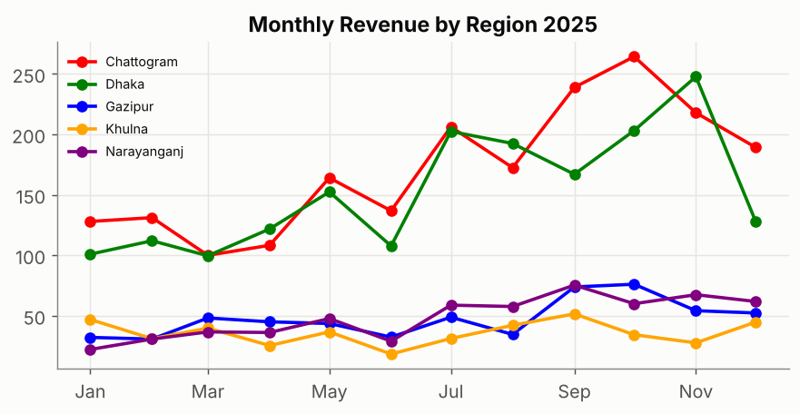
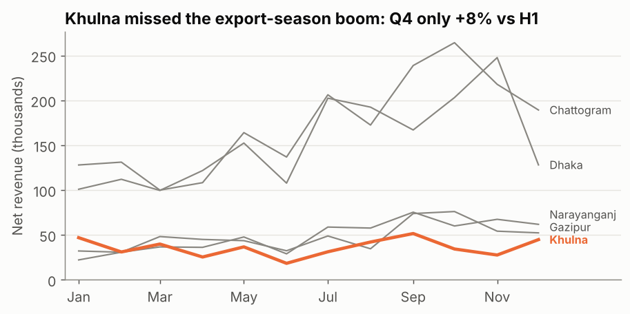

## What is it?

| | Exploratory charts | Explanatory charts |
|---|---|---|
| **Purpose** | Help *you* find things | Help *others* understand one thing |
| **Audience** | You, analysts | Managers, clients, readers |
| **Style** | Many series, interactive, hover and zoom | One message, highlighted, labelled, static is fine |
| **Tool here** | **Plotly** | matplotlib, with **storytelling** design |

**Analytical storytelling** is turning findings into a short, logical sequence: *context → finding → evidence → so what → recommendation*, with each chart supporting one step.

!!! job "Why it matters at work"
    Interactive charts let stakeholders explore without asking you for every cut. But decisions are made from a few clear charts and sentences. Analysts who can redesign a cluttered chart into one obvious message are the ones invited to present to leadership.

The script is `16_viz_plotly_storytelling.py`.

## Part 1: Plotly Express — interactive in one call

```python
import plotly.express as px

monthly = net.groupby(["month", "segment"], as_index=False)["revenue"].sum()
fig = px.line(monthly, x="month", y="revenue", color="segment", markers=True,
              color_discrete_sequence=PALETTE,
              labels={"month": "", "revenue": "Net revenue", "segment": "Segment"},
              title="Garment factories drive the export-season peak")
fig.update_layout(template="simple_white", hovermode="x unified", legend_title_text="")
fig.update_yaxes(rangemode="tozero", tickformat=",.0f")
fig.update_xaxes(hoverformat="%B %Y", dtick="M2", tickformat="%b")
fig.update_traces(hovertemplate="%{y:,.0f}")                   # clean hover text: just the value
fig.write_html(CHARTS / "viz_plotly_monthly.html", include_plotlyjs="cdn")
```



*(Screenshot of the HTML file with the mouse over September.)*

- **One call** with tidy data: `x`, `y` and `color` are column names, like seaborn.
- **Interactive for free:** hover for values, drag to zoom, double-click to reset, click a legend item to hide that series, camera icon to download a PNG.
- `hovermode="x unified"` shows all segments for one month in one box; `hovertemplate` controls the text.
- `write_html` creates a file anyone can open in a browser. `include_plotlyjs="cdn"` keeps it small (about 12 KB) but needs internet. Use `include_plotlyjs=True` for a fully **offline** file (about 4.8 MB).
- In a notebook (Jupyter, VS Code), `fig.show()` displays it inline.

### Exploring with hover

```python
cust = net.groupby(["customer_id", "segment", "region"], as_index=False).agg(
    orders=("order_id", "size"), revenue=("revenue", "sum"))
fig2 = px.scatter(cust, x="orders", y="revenue", color="segment", size="revenue", hover_name="customer_id",
                  hover_data={"region": True, "revenue": ":,.0f"}, log_y=True, color_discrete_sequence=PALETTE,
                  title="Customers: number of orders vs total revenue (hover for details)")
```

```text
customer_id         segment region  orders  revenue
       C010 Garment Factory  Dhaka     201 295414.0
       C044 Garment Factory  Dhaka     161 255781.0
       C037 Garment Factory Khulna     152 225647.0
```

Sixty customers as dots: hover to see who each one is. Perfect for exploring, or for sharing with a sales manager who wants to look up "their" customers. Not the chart you'd put on a slide.

## Part 2: storytelling — redesign a chart

**The finding** (from the data): every region grows strongly in the export season *except one*.

```python
growth = (q4 / 3) / (h1 / 6) - 1                 # monthly average Q4 vs first half
print((growth * 100).round(0).sort_values(ascending=False))
```

```text
region
Narayanganj    87.0
Chattogram     75.0
Dhaka          67.0
Gazipur        57.0
Khulna          8.0
dtype: float64
```

### Before



All the data is there, but the reader has to match five colours to a legend and still doesn't know what to look at. The title describes; it doesn't say anything.

### After

```python
focus = growth.idxmin()                                   # Khulna
for col in reg.columns:
    is_focus = col == focus
    ax.plot(reg.index, reg[col], color=PALETTE[1] if is_focus else MUTED,
            linewidth=2.6 if is_focus else 1.2, zorder=3 if is_focus else 2)
    ax.text(reg.index[-1] + pd.Timedelta(days=8), label_y[col], col, va="center", fontsize=9,
            color=PALETTE[1] if is_focus else INK_2, fontweight="bold" if is_focus else "normal")
ax.set_title(f"{focus} missed the export-season boom: Q4 only {growth[focus]:+.0%} vs H1")
```



| Change | Why it works |
|---|---|
| **Action title** with the number | The message is read first, in one line |
| **One highlight colour**, others grey | The eye goes straight to Khulna; context stays visible |
| **Direct labels** instead of a legend | No back-and-forth matching (labels nudged apart so they don't overlap) |
| Markers and vertical gridlines removed | Less ink that carries no information |
| Y-axis from zero, units in the label | Honest scale, readable values |

## Part 3: a five-sentence data story

> **Context:** 2025 revenue followed the export season, with every region growing from July.
> **Finding:** Khulna is the exception: its Q4 monthly revenue was only 8% above the first half, against 57–87% elsewhere.
> **Evidence:** (the "after" chart). Khulna also has the slowest and least predictable deliveries (median 5 days, up to 17) and 26% late deliveries.
> **So what:** If Khulna had grown like Gazipur (+57%), Q4 revenue would have been roughly 50 thousand higher.
> **Recommendation:** Investigate delivery capacity to Khulna before next season, and test a faster-delivery offer with a few Khulna customers.

Each sentence has one job, and each number is checkable. (Is "50 thousand" right? Khulna's H1 monthly average × 3 months × the growth gap. Recompute it as an exercise. Always check your story's numbers.)

## Common mistakes

| Mistake | What happens | Fix |
|---|---|---|
| Showing exploratory charts in a presentation | The audience explores instead of listening | One message per chart, highlighted |
| Rainbow colours with a legend | Slow, error-prone reading | Grey + one highlight, direct labels |
| Interactive HTML relying on the CDN, sent to someone offline | A blank page | `include_plotlyjs=True` for offline files |
| Story without a "so what" | "Interesting", then nothing happens | End with a recommendation and owner |
| Cherry-picking the one chart that supports you | Lost trust when someone checks | Show the context, state caveats |

## Try it yourself

**Task:** Make an interactive **horizontal bar chart** of 2025 revenue by product, coloured by category and sorted by revenue. Which three products earn the most?

<details markdown="1">
<summary>Show the solution</summary>

```python
prod = net.groupby(["product", "category"], as_index=False)["revenue"].sum().sort_values("revenue")
fig3 = px.bar(prod, x="revenue", y="product", color="category", orientation="h", color_discrete_sequence=PALETTE,
              title="Revenue by product, 2025")
fig3.update_layout(template="simple_white", yaxis={"categoryorder": "total ascending"})
fig3.write_html(CHARTS / "viz_plotly_products.html", include_plotlyjs="cdn")
print(prod.tail(3).round(0).to_string(index=False))
```

```text
        product category  revenue
    Jersey Knit   Fabric 597764.0
Cotton Yarn 30s     Yarn 614595.0
     Denim 12oz   Fabric 680805.0
```

Denim 12oz, Cotton Yarn 30s and Jersey Knit. `categoryorder: "total ascending"` keeps the bars sorted even with colours by category.
</details>

## Quick quiz

<div class="quiz-q" markdown="1">
1\. When is an interactive Plotly chart the better choice?

1. For a slide with one key message
2. For exploring data, or letting stakeholders look up details themselves
3. Always

<details markdown="1"><summary>Show answer</summary>
**B.**
</details>
</div>

<div class="quiz-q" markdown="1">
2\. What's the most effective way to focus attention on one series among five?

1. Give every series a bright colour
2. Grey for context, one highlight colour, direct labels
3. Add more gridlines

<details markdown="1"><summary>Show answer</summary>
**B.**
</details>
</div>

<div class="quiz-q" markdown="1">
3\. Which part completes a data story after context, finding and evidence?

1. More charts
2. So what, and a recommendation
3. The raw data

<details markdown="1"><summary>Show answer</summary>
**B.**
</details>
</div>

## Summary

- **Plotly Express**: interactive charts in one call; `write_html` to share (`"cdn"` small, `True` offline).
- Separate **exploratory** charts (for you) from **explanatory** charts (for others).
- Redesign for one message: **action title, one highlight, grey context, direct labels, less ink**.
- Tell the story in five steps: **context → finding → evidence → so what → recommendation**, with checkable numbers.

!!! job "Job-ready check"
    **Interview question:** *"Show me how you'd present this analysis to a busy executive."*

    **Strong answer:** "One headline sentence with the finding and the number, one chart designed around that message (action title, the key series highlighted, everything else grey), then the so-what and a concrete recommendation with an owner. The detailed or interactive charts go in an appendix or a link for anyone who wants to explore."

    **Mini project:** Pick one finding from your EDA note. Make a "before" chart with default settings and an "after" chart using the storytelling checklist, and write the five-sentence story underneath.
